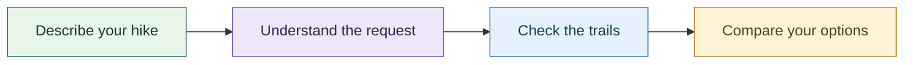
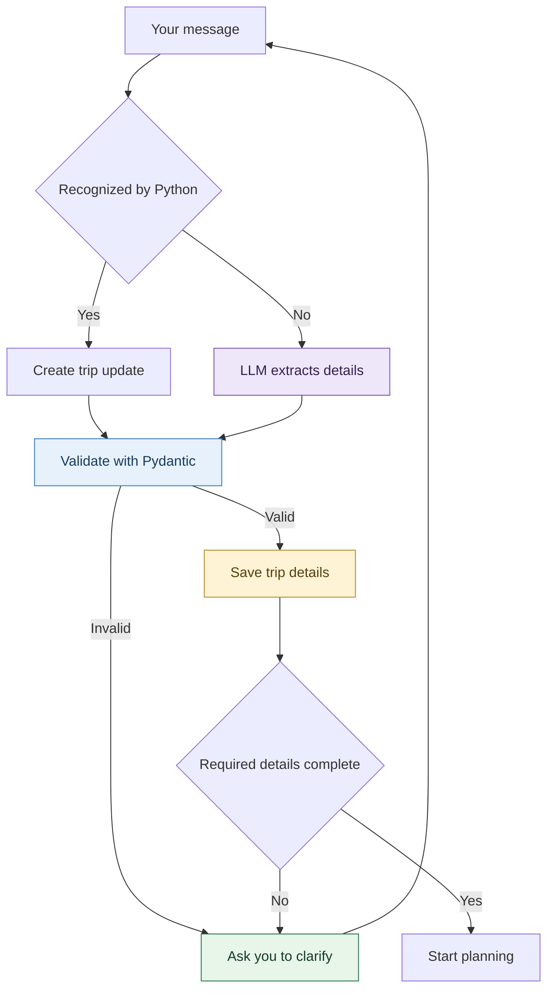
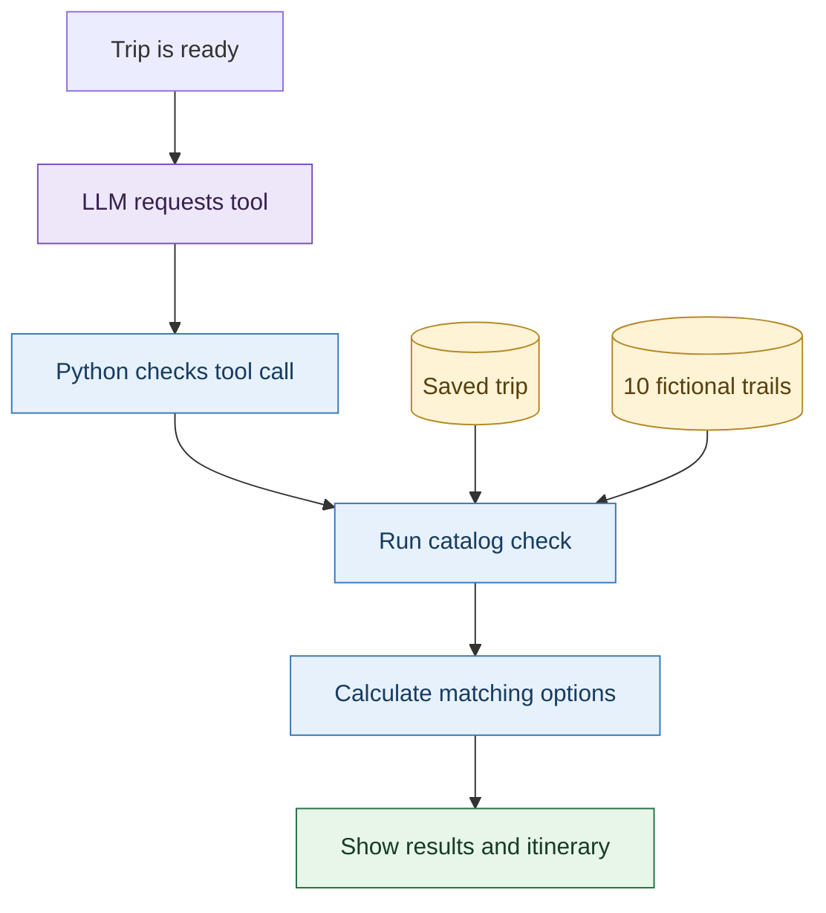

# Pick Our Hike

A local hiking-planning demo for one organizer, 1-5 hikers and up to 5 optional dogs.
Compare ten fictional demo trail routes against the group's distance, ascent, driving and time limits.
The fixed meeting point is Redlands City Hall, California.

## Start here

Follow [Setup, startup and shutdown](SETUP_START_AND_STOP.md). You need Python 3.12,
Ollama and the `phi4-mini` model. No hosted API key is required. The app never
installs a model automatically. Internet access is needed for initial installation.

After setup, run from the project folder:

```powershell
.venv\Scripts\python.exe -m streamlit run app.py --server.address 127.0.0.1 --server.port 8501
```

Open http://127.0.0.1:8501. Keep the terminal running.

Example:

> Plan a hike on October 11, 2026, leaving at 8 AM and returning by 5 PM. Sam and Alex can each hike up to 4 miles with 600 feet of ascent. No dogs. We prefer driving less than one hour each way.

Use the same chat to change details. Review the Results and Trip details tabs.
Use **View hike** to inspect an itinerary. Starting a new trip clears the in-memory conversation.

## Architecture

### The big picture



### 1. Understand the conversation

Python handles supported phrases. Other wording goes to **phi4-mini**, running
locally through Ollama. Both paths produce trip updates for validation.



Earlier trip details carry forward unless you change them. Clarification answers
continue the same conversation.

### 2. Check the hiking options

The LLM requests the catalog tool. Python checks that request and runs the tool;
if the model's request fails, Python runs the same tool as a fallback.



### Responsibilities

| Component | Responsibility |
|---|---|
| **Streamlit UI** | Chat, hiking options and trip details |
| **Local LLM** | Interpret other wording and request the catalog tool |
| **Pydantic + Python** | Validate updates, convert units and retain trip details |
| **Python tools** | Check distance, ascent, dog rules, hours and driving limits; calculate the itinerary |
| **Local JSON files** | Supply fictional trails, weather and travel values |

If no trail matches, the app asks which limits you would consider changing.
Send another message to update the trip and check again. The default setup runs
locally without external park, weather or map API calls. These diagrams show the
normal planning flow.

## How it actually works

1. Python recognizes supported input patterns and short answers to pending questions.
2. Unrecognized wording goes to the local LLM for structured extraction. Pydantic validates updates; Python converts units and preserves state.
3. Once required facts are present, the app asks the LLM to request the read-only catalog-checking tool. If that request fails or is invalid, Python runs the same tool as fallback. The UI still requires Ollama and the configured model to be available before accepting chat input.
4. Python checks all catalog routes against saved trip constraints and calculates itineraries. Missing dates, departure/return times, hikers or hiking distance limits trigger clarification. Results are checks against fictional data, not real trail conditions.

This is a **hybrid, Python-led demo**, not a fully autonomous LLM planner. Local-model
interpretation is not reliable for every phrasing. Review the saved trip details before
relying on a result.

## Data, privacy and limitations

- Both files in `data/demo` contain invented trails, metrics, rules, weather and travel times.
- The Redlands City Hall meeting label is real; the routes and travel estimates are fictional.
- No third-party trail content, map tiles, photos, reviews or forecast snapshots are bundled.
- The app does not fetch live maps, weather, traffic or park data.
- Results demonstrate group constraints and itinerary calculations, not real travel suitability.
- The local trail illustration is conceptual artwork.
- Chat state is in memory. Clear notebook outputs before sharing them.
- Ollama defaults to localhost; changing `OLLAMA_HOST` changes where prompts are sent.

See [Data and asset notes](DATA_AND_ASSETS.md).

## Project layout

| Path | Purpose |
|---|---|
| `app.py` | Streamlit UI |
| `src/pick_our_hike/agent.py` | State, validation, conversation flow and tools |
| `src/pick_our_hike/explicit_trip_updates.py` | Supported Python language patterns and short-answer handling |
| `src/pick_our_hike/trip_extraction.py` | LLM extraction schema and unit normalization |
| `src/pick_our_hike/planning_dispatch.py` | LLM tool request and checked fallback |
| `src/pick_our_hike/trip_evaluation.py` | Group constraints and itinerary calculations |
| `data/demo/` | Required offline catalog and context |
| `assets/` | Local artwork and CSS |
| `tests/` | Focused automated checks |
| `output/jupyter-notebook/debug_agent_conversation.ipynb` | Optional debugger; model calls disabled by default |

## Development

Install test dependencies with `.venv\Scripts\python.exe -m pip install pytest`.
The automated suite uses simulated model responses; Ollama does not need to be running.
Run the full suite with `.venv\Scripts\python.exe -m pytest -q`, or select checks relevant to a change:

```powershell
.venv\Scripts\python.exe -m pytest tests/test_planning_dispatch.py tests/test_trip_extraction.py -q
```

For reproducible dependency resolution, `uv.lock` is included; `uv sync --locked`
can be used instead of pip if uv is already installed. Ollama and its model are
installed separately. The project is intended to run from its full source checkout;
keep `data` and `assets` alongside `app.py`.

## License

No project-wide software license is currently specified. Third-party packages
and models retain their respective licenses.
